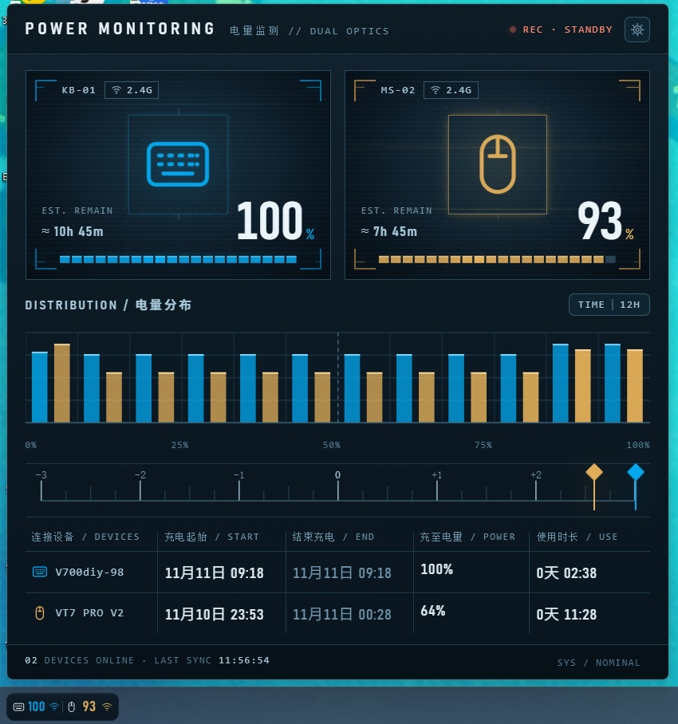

# Peripheral Power Monitoring

**外设电量监测 / 键鼠电量监测** —— Windows 任务栏上的无线外设电量监视器。



## ⚠️ 设备支持声明

**本项目仅适配以下两款设备，其他设备没有适配、不会显示任何数据：**

- 键盘：**雷柏 V700 DIY-98 LRV**
- 鼠标：**雷柏 VT7 PRO V2**

程序通过逆向这两款设备 2.4G 接收机的私有 HID 报文获取电量，换任何其他型号（包括雷柏自家其他型号）都无法工作。

**想给自己的设备适配？** 欢迎 Fork 本仓库。先用配套的 [外设抓包工具](https://github.com/Alioneo/Peripheral-Capture-Tool) 抓一份你设备的原始报文，再把 `src/protocol.rs` 和抓包结果一起交给 AI 助手（如 Claude、GPT 等），说明设备型号，通常需要修改的只是 VID/PID 和设备帧的解析规则，界面与系统层代码完全不用动。

## 配套抓包工具

本项目只适配了两款雷柏设备，其他型号需要先弄清楚自己的电量协议。为此单独做了一个面向所有键鼠的抓包工具：

**👉 [Peripheral-Capture-Tool · 外设抓包工具](https://github.com/Alioneo/Peripheral-Capture-Tool)**

- 图形界面向导，7 步走完：选择设备 → 2.4G → 有线 → 蓝牙 → 充电状态 → 电量变化 → 生成报告
- 每步都有操作提示、开始/结束按钮和倒计时，不需要抓包经验
- 自动发现所有 HID 接口，支持任意品牌键鼠，不限于雷柏
- 输出 `frames.jsonl`（逐帧原始数据）、`设备与字段分析.md`（字节分布与候选字段）、`给AI的说明.md`
- 绿色单 exe，不写注册表、不联网，解压即用

抓完之后把整个结果文件夹发给 AI，让它给出电量字段、充电状态字段和解析代码，再照着改 `src/protocol.rs` 即可完成适配。

下载：[Releases](https://github.com/Alioneo/Peripheral-Capture-Tool/releases/latest)

## 功能

- **任务栏入口**：原生 GDI+ 绘制的电量胶囊，双设备电量 + 链路图标（2.4G / USB-C）+ 充电绿色呼吸闪电，4× 超采样无锯齿
- **大卡片**（点击入口弹出）：电量直方图（12 组 / 12 小时）、剩余续航估算（按真实掉电速率学习）、充电起始/结束记录、使用时长
- **充电记录**：插电记起始、拔电记结束与充至电量；休眠唤醒、软件重启等场景自动对账，不会写脏数据
- **设置页**：设备改名、深/浅/跟随系统主题、低电量阈值与 Win11 原生通知、开机自启、托盘图标开关，全部即时保存即时生效
- **休眠友好**：键鼠休眠保留上次读数不变暗，启动时先显示落盘读数

## 安装与卸载

到 [发行版](../../releases) 下载安装包：

- 可自定义安装目录（默认 `Program Files\RapooBattery`）
- 在 Windows 设置 → 应用 中可正常卸载
- 卸载会删除全部内容：程序文件、注册表（含开机自启项）、`%LOCALAPPDATA%\RapooBattery` 下的日志与记录，无残留

运行数据（配置、日志、充电记录等）存放在 `%LOCALAPPDATA%\RapooBattery`，日志上限 10MB 自动截断，除此之外不产生任何其他文件，不联网。

## 自行构建

```bash
cargo build --release
```

产物是单文件 exe（约 600KB，WebView2 运行时由系统提供）。

打包安装器（需安装 [NSIS 3](https://nsis.sourceforge.io/)）：

```bash
makensis installer.nsi
```

## 技术栈

Rust + Win32 API（分层窗口 / 托盘 / RawInput HID）+ GDI+（入口绘制）+ WebView2（大卡片 UI，HTML 内嵌于 exe）。除 `wry` 外无第三方依赖。

## 许可证

[MIT](LICENSE)
